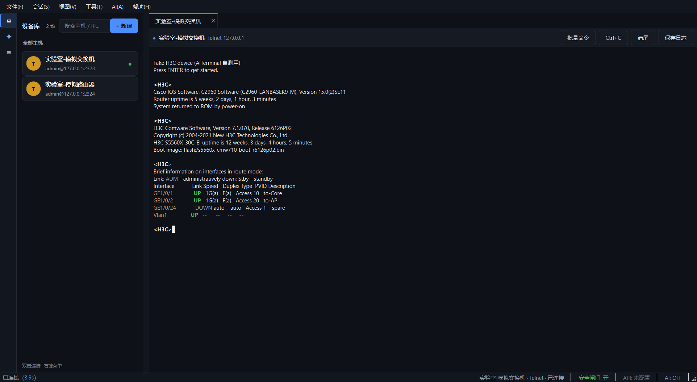
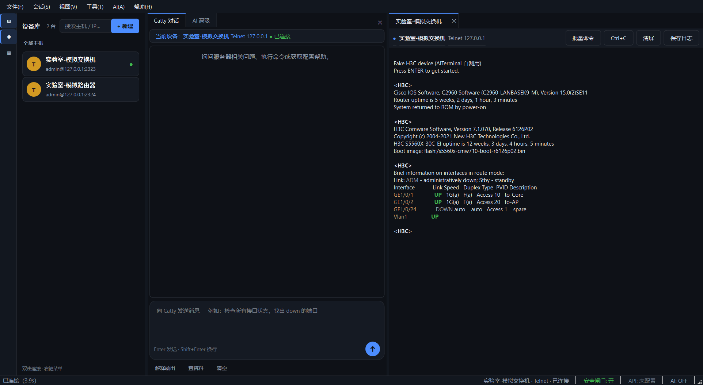
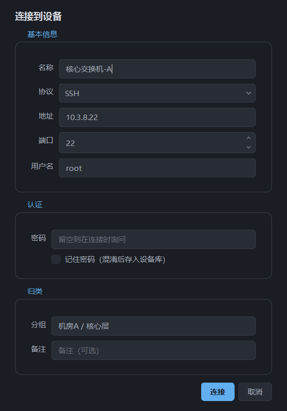

<div align="center">

# NetOps Terminal · 网络运维终端

**把网络设备的命令行，变成能对话、能巡检、能留痕的运维工作台**

SSH / Telnet / 串口 Console / eNSP Pro 四种连法 · AI 辅助排障与命令生成 · 多设备巡检 · 批量下发 · 危险命令闸门




</div>

---

## 目录

- [这是什么](#这是什么)
- [和普通终端有什么不同](#和普通终端有什么不同)
- [功能](#功能)
- [界面](#界面)
- [快速开始](#快速开始)
- [第一次连接](#第一次连接)
- [配置 AI（可选）](#配置-ai可选)
- [目录结构](#目录结构)
- [开发与测试](#开发与测试)
- [安全设计](#安全设计)
- [已知限制](#已知限制)
- [文档](#文档)
- [许可证](#许可证)

## 这是什么

网络设备的日常运维，一半时间花在「敲命令 → 看输出 → 判断下一步」这个循环里。NetOps Terminal 把这个循环做完整：

- **一个终端连到底**：SSH、Telnet、串口 Console、华为 eNSP Pro 仿真设备，四种连法共用同一套终端体验，多标签并行；
- **AI 看得见屏幕**：把设备输出喂给大模型（Claude / DeepSeek / 任意 OpenAI 兼容接口），让它解释报错、给出下一条命令，而且**命令要不要执行由你点确认**；
- **能批量、能留痕**：多设备并发巡检、按提示符判断的批量下发、配置快照比对、结果导出 Excel，日志自动落盘。

纯 Python + PyQt6 桌面应用，Windows 单文件 exe、Linux 单文件可执行，不需要装浏览器套壳、不需要后端服务。

## 和普通终端有什么不同

| | MobaXterm / SecureCRT / PuTTY | NetOps Terminal |
| --- | --- | --- |
| 连接方式 | SSH / Telnet / Serial | 同上 **+ eNSP Pro 仿真平台直连** |
| 看懂输出 | 只显示 | AI 解释报错、判断下一步、给出命令 |
| 命令从哪来 | 自己记 | 本地资料库 → 厂商知识库 → 联网检索，三级兜底 |
| 批量操作 | 一般没有 | 多设备并发巡检、按提示符批量下发、模板下发 |
| 危险命令 | 全靠人 | 代码级拦截 + 配置命令二次确认 |
| 留痕 | 手工复制 | 自动分设备落盘、配置快照行级比对、Excel 导出 |
| 可被自动化 | 一般没有 | 本地控制通道，允许外部智能体（DSH / MCP）驱动 |

## 功能

### 连接与终端

- **四种连接**：SSH（密码 / 密钥，Paramiko）、Telnet（含不支持 Telnet 选项的设备回退实现）、串口 Console、华为 eNSP Pro 仿真设备
- **串口对齐 MobaXterm 的兼容性**：数据位 / 校验位 / 停止位、四种流控、DTR / RTS 电平、**Break 信号**（进 BootROM）、运行时切波特率、字符发送间隔、断线自动重连、端口枚举带设备描述、端口占用报错可读
- **终端体验**：ANSI 颜色清洗、`\r` 进度条覆盖、命令历史（↑↓）、`Ctrl+F` 在输出里查找、`Ctrl+±` 缩放字号、`Ctrl+C` 中断设备输出、`Ctrl+Shift+C` 复制选区、清屏、一键保存日志
- **分页自动处理**：遇到 `---- More ----` 自动翻页，长输出不会卡在分屏
- **设备库**：保存常用设备（不含密码），双击直连，连接状态在左侧实时可见
- **会话恢复**：退出时记住会话列表，下次一键重连

### AI 助手

- **多提供方**：Anthropic Claude、DeepSeek、任意 OpenAI 兼容接口（vLLM、Ollama、中转站、自建网关），密钥 / 模型 / 接口地址分开保存，切换互不覆盖
- **两种面板**：`Catty 对话`（自然语言提问 + 解释当前输出）、`AI 高级`（提示词、待执行队列、自动模式）
- **建议模式**：AI 只给命令，人工确认后才发到设备
- **自动模式**：输出稳定后自动分析，配置类命令只入待执行队列，不会自己下发
- **AI 能上网查**：内置联网检索后端（百度 / 必应 / DuckDuckGo / SearXNG），拿不准语法或报错含义时先查资料再回答，回答带可点击来源
- **本地模型可选**：接 llama.cpp 本地推理与向量检索，断网也能用（`local_llm/`）

### 资料与知识库

- **本地资料库**：把下载好的命令手册、配置案例、培训文档导入，自动抽取正文建索引；查命令时**先查本地，再联网**
- **格式覆盖**：PDF / Word / Excel / PPT / txt / md / html / csv / 日志 / 配置文件 / zip
- **厂商知识库**：结构化命令索引（华为 / 新华三 / 思科 / 锐捷），按特性查命令、查示例
- **沉淀机制**：查到的命令一键存为带元信息（时间 / 设备 / 厂商 / 标签）的笔记，越用越厚；笔记可筛选、合并导出成手册（Markdown / 可打印 HTML）

### 巡检 / 批量 / 变更

- **多设备并发巡检**：同时对多台设备跑同一组命令，结果导出 Excel（巡检信息 / 巡检汇总 / 命令明细 三个工作表）
- **批量下发**：按提示符判断命令完成，自动翻页，遇到 `[Y/N]` 暂停交人工，结果可导出
- **命令模板**：创建 VLAN / 配接口 IP / 静态路由 / 巡检 / 备份等模板，填变量 → 预览 → 下发
- **配置快照与比对**：一键采集 `display current-configuration`，行级着色对比两次配置差异，可导出 unified diff
- **命令补全**：三层补全（厂商命令 → 模板 → 历史），Tab 触发，输入直接内联显示在终端正文

### 自动化接口

- **本地控制通道**（`core/control_api.py`）：让外部智能体（DSH / MCP）驱动**正在运行的**实例——读屏、写命令、跑巡检，不必截图模拟点击

## 界面

<table>
<tr>
<td width="50%"><br><sub>AI 面板：左边对话，右边终端，AI 看得见当前屏幕内容</sub></td>
<td width="50%"><br><sub>新建连接：SSH / Telnet / 串口 / eNSP Pro 四类参数</sub></td>
</tr>
</table>

## 快速开始

### 方式一：直接跑可执行文件（推荐给使用者）

- **Windows**：下载 `NetOpsTerminal.exe` 双击运行，无需安装 Python
- **Linux**：下载 `NetOps Terminal`（单文件 ELF）+ `install.sh`，按 [README-Linux.md](README-Linux.md) 安装

### 方式二：源码运行（推荐给开发者）

```bash
git clone https://github.com/Linyin42/netops-terminal.git
cd netops-terminal

python -m venv .venv
# Windows: .venv\Scripts\activate
source .venv/bin/activate

pip install -r requirements.txt
python main.py
```

Windows 下也可以直接双击 `run.bat`（首次运行自动创建虚拟环境并装依赖）。

**环境要求**：Python 3.10+（开发与打包实测 CPython 3.12 / 3.13）、PyQt6 6.6+、Paramiko、pyserial。不装 AI 相关依赖也能用——AI 只是增强功能，纯终端部分照常工作。

### 方式三：接真实设备前先自检

不用打开界面，也不用把密码贴到任何地方，命令行几分钟就能确认链路是否正常：

```bash
# 离线自检（不需要设备、不联网）
python tests/smoke_test.py

# 用内置模拟设备跑通整条链路
python tools/fake_device.py --port 2323 --no-login      # 终端 A
python tools/verify_device.py --protocol telnet --host 127.0.0.1 --port 2323   # 终端 B

# 验证真实设备（密码交互式输入，不落历史）
python tools/verify_device.py --protocol ssh --host 10.0.0.1 --user admin
python tools/verify_device.py --protocol serial --serial-port COM3 --baudrate 9600
python tools/verify_device.py --list-ports
```

它会依次报告：连接是否成功 → 厂商识别 → 关闭分屏 → 每条命令能否「等提示符返回」地跑完。完整流程见 [docs/验证指南.md](docs/验证指南.md)。

## 第一次连接

1. 点左上角 **+ 新建**，选协议（SSH / Telnet / Serial / eNSP Pro）填地址与凭据；
2. 连上后设备自动进左侧**设备库**（不保存密码），下次双击直连；
3. 华为 / 新华三设备建议先执行 `screen-length 0 temporary`（Cisco 是 `terminal length 0`）关掉分屏；
4. 需要 AI 时点左侧 ✦ 图标唤出面板，或 `Ctrl+I` 进 AI 自动模式。

**连不上时按这个顺序排查**：端口是否被别的软件占用 → 波特率（9600 / 115200）→ 帧格式 8-N-1 → 行结束符用 CR → 丢字符就加字符发送间隔。

## 配置 AI（可选）

在界面右侧 AI 面板里选提供方并填写即可，配置文件落在 `~/.aiterminal/settings.json`：

| 提供方 | 需要填 | 说明 |
| --- | --- | --- |
| DeepSeek | `sk-` 开头的 API Key | 默认推荐，中文命令理解好 |
| Anthropic Claude | `sk-ant-` 开头的 API Key | 也可用 `.env` 的 `ANTHROPIC_API_KEY` |
| OpenAI 兼容接口 | 接口地址 + 模型名 + 可选 Key | vLLM / Ollama / 中转站 / 自建网关 |
| 本地模型 | 模型文件路径 | 走 llama.cpp，可完全离线 |

复制 `.env.example` 为 `.env` 可预置 Anthropic 配置；`.env` 已在 `.gitignore` 里，不会被提交。

## 目录结构

```
aiterminal/
├── main.py              # 入口（同时支持 --script <脚本> 跑随包脚本）
├── core/                # 连接器（SSH / Telnet / 串口 / eNSP）、会话、终端模拟、
│                        # AI 智能体、大模型客户端、本地资料库与 RAG、联网检索、
│                        # 多设备巡检、批量下发、配置比对、安全分级、Excel 写入、
│                        # 本地控制通道
├── ui/                  # 主窗口、终端控件、会话标签、设备库、AI 面板 / 对话面板、
│                        # 巡检 / 模板 / 比对 / 串口控制 / 资料库对话框、主题
├── engine/              # 引擎侧代码与随包工具
├── local_llm/           # llama.cpp 本地模型：探测、启动、嵌入、向量检索
├── config/              # 配置读写、厂商命令库、命令模板
├── plugins/             # 插件基类与插件管理器
├── resources/           # 图标与 QSS 样式
├── docs/                # 开发文档、验证指南、界面截图
├── tests/               # 冒烟测试、回归测试、模块单测
├── tools/               # 验证脚本、模拟设备、探测与构建工具
├── build.spec           # Windows 打包配置（PyInstaller）
├── build-linux.sh       # Linux 打包脚本
└── NetOpsTerminal-linux.spec# Linux 打包配置
```

> 厂商知识库（`knowledge/`，体积较大）不随仓库发布，首次使用请在界面里导入资料或按 [docs/README.md](docs/README.md) 的方式本地构建。

## 开发与测试

```bash
python tests/smoke_test.py          # 离线冒烟：不联网、不需要设备，覆盖终端清洗 /
                                    # 厂商识别 / 危险命令拦截 / 模板 / 日志 / 比对 /
                                    # 检索 / 串口 / Excel 写出 / 巡检链路
python tests/regression_fixes.py    # 回归用例（83 项）
python tests/test_command_safety.py # 只跑危险命令分级
```

打包：

```bash
# Windows → dist\NetOpsTerminal.exe
build.bat

# Linux → dist/NetOpsTerminal（需要 python3-dev / libgl1 / libxcb-* 等，脚本里已列）
bash build-linux.sh
```

## 安全设计

| 机制 | 位置 | 行为 |
| --- | --- | --- |
| 危险命令拦截 | `core/ai_agent.py::DANGEROUS_PATTERNS` | `reboot` / `delete` / `erase` / `factory-reset` / `clear configuration` / `undo vlan` 等直接拒绝下发 |
| 命令安全分级 | `core/safety.py` | 区分只读命令与配置命令，配置命令必须人工确认 |
| 配置命令二次确认 | `ui/command_confirm.py` | 下发前列出完整命令清单，逐条确认 |
| 凭据处理 | `config/settings.py` | 设备库不存密码；密码只在内存里传给连接器；`.env` / `settings.json` 不入库 |

**这个工具能让 AI 碰你的生产网络，请先看懂上面这张表再用自动模式。**

## 已知限制

- 主窗口只能拖动自绘标题行移动，缩放靠右下角 `QSizeGrip`；六个功能对话框不可缩放
- 巡检默认命令集以华为语法为主，跨厂商使用请自备命令或改用模板
- Linux 版在 Wayland 下依赖系统安装中文字体（Noto CJK / 文泉驿），否则界面中文显示为方块
- `knowledge/` 厂商知识库未随仓库发布，需要本地导入或构建
- eNSP Pro 直连需要本机能访问仿真平台的 REST 接口
- 串口热插拔与「端口正在使用」提示未做完整实测

## 文档

- [docs/README.md](docs/README.md) — 架构说明、模块职责、数据流、功能细节、与设计稿的差异
- [docs/验证指南.md](docs/验证指南.md) — 14 项真机验证清单
- [README-Linux.md](README-Linux.md) — Linux 打包、安装、依赖与字体问题
- [ARCHITECTURE.md](ARCHITECTURE.md) / [API-CONTRACT.md](API-CONTRACT.md) / [FEATURE-TESTS.md](FEATURE-TESTS.md) — 架构、接口契约、功能与测试对照

## 许可证

[MIT](LICENSE) © 2026 Linyin42
